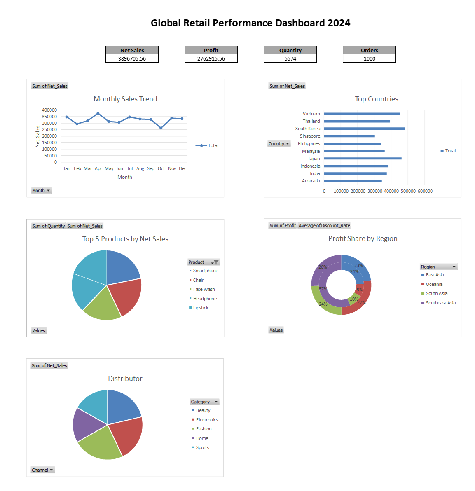
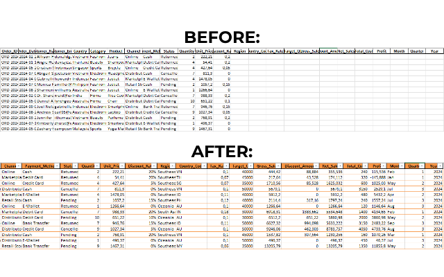
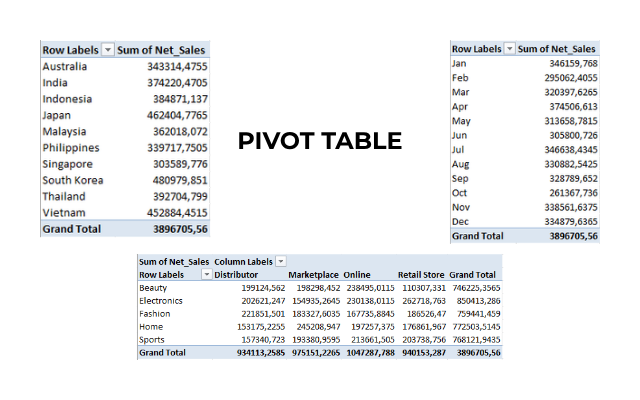

# Global-Retail-Performance-Dashboard-2024
Analisis penjualan retail global dengan 1.000 transaksi di 10 negara, dengan menggunakan Excel (VLOOKUP/HLOOKUP/Pivot) untuk analisis, dan dashboard interaktif untuk insight bisnis.

#### Tujuan:
1. Melakukan data enrichment menggunakan VLOOKUP.
2. Menghitung metrik bisnis (Gross Sales, Net Sales, Profit, Margin).
3. Membuat 5 Pivot Table untuk analisis multidimensi.
4. Menyusun dashboard interaktif dengan insight bisnis yang actionable.

#### Sheet dalam File Excel

| Sheet | Isi | 
|---|---|
| RAW_DATA | Data mentah (13 kolom) |
| REF_Country | Master negara (region, kode, tax rate) | 
| REF_Target | Target Q1–Q4 per kategori |
| REF_Cost | Harga modal per kategori | 
| ANALYSIS | Data + 12 kolom hasil rumus |
| Pivot_1 – Pivot_5 | 5 Pivot Table analisis | 
| DASHBOARD | Dashboard visual | 

#### Proses yang Dilakukan
1. Data Enrichment (VLOOKUP)   Melengkapi kolom kosong dengan data dari tabel referensi:   - Region (dari REF_Country)   - Country Code (dari REF_Country)   - Tax Rate (dari REF_Country)   - Target Q1 (dari REF_Target)   - Cost Per Unit (dari REF_Cost)
2. Kalkulasi Metrik Penjualan   Menghitung kolom turunan menggunakan rumus aritmatika, seperti:   - Gross Sales (Quantity × Unit Price)   - Discount Amount (Gross Sales × Discount Rate)   - Net Sales (Gross Sales − Discount Amount)   - Total Cost (Cost Per Unit × Quantity)   - Profit (Net Sales − Total Cost)
3. Ekstraksi Dimensi Waktu   Membuat kolom waktu dari Order_Date, seperti:   - Month (nama bulan)   - Quarter (Q1–Q4)   - Year (tahun)
4. Analisis Pivot Table    Membuat Pivot Table untuk analisis, seperti:   - Pivot Net Sales per Country   - Pivot Trend Penjualan Bulanan   - Pivot Category × Channel   - Pivot Top 5 Products   - Pivot Region Performance 
5. Visualisasi Chart   Membuat chart dari Pivot Table, seperti:   - Line Chart (trend bulanan)   - Horizontal Bar Chart (top countries)   - Pie Chart (category × channel)   - Pie Chart (top 5 products)   - Doughnut Chart (profit by region)
6. Pembuatan Dashboard   Menyusun dashboard interaktif yang berisi:   - 4 KPI Cards (Total Net Sales, Profit, Quantity, Orders)   - 5 Chart dari Pivot Table

#### Dashboad Preview

